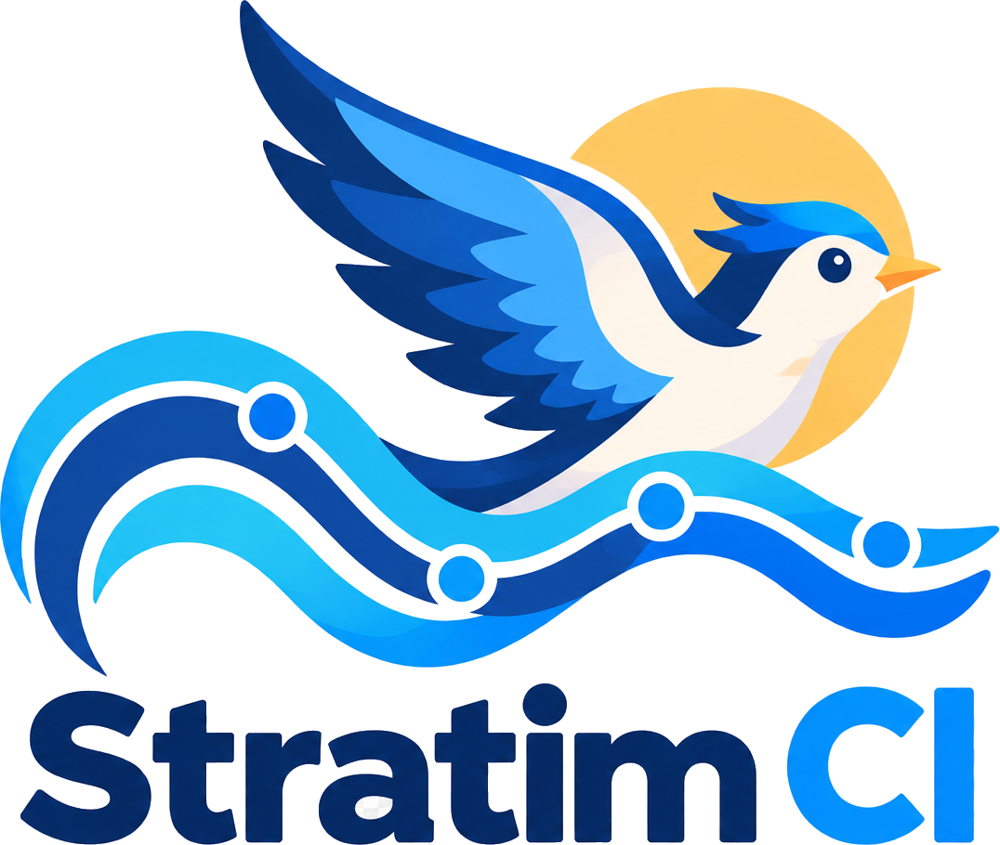

# Stratim CI

  

Stratim CI is a CI/CD server modelled on TeamCity and built on an open codebase.
It is a hard fork of [Woodpecker CI](https://github.com/woodpecker-ci/woodpecker).

> **Status:** the fork has just been created. The code is still Woodpecker's `main` as of
> 2026-10-20 (`02c3c055a`); the renaming and the features below have not landed yet.

## Direction

- **Build chains like TeamCity's:** a tree of projects and build configurations,
  snapshot and artifact dependencies between pipelines, reuse of suitable builds,
  and a tree view of the chain in the UI.
- **Tests as first-class data:** per-test results, history and rerunning a single test.
- **Artifacts on S3**, with retention rules.
- **Performance monitor:** CPU, memory and IO of every step, with a selected stretch of
  the graph opening the log lines written during it.
- **Native jsonnet** pipeline configuration.
- **Secrets** encrypted at rest, with history and external stores.
- **MariaDB** as the only database.
- **Agents** on EC2 (pools, autoscaling) and on bare-metal hosts.
- **A status board** for pull requests, main and cron builds.

## License

Stratim CI is Apache 2.0 licensed, like Woodpecker, from which it inherits most of its code.
The source files have a header indicating which license they are under and what copyrights apply.

Everything in `docs/` is licensed under the Creative Commons Attribution-ShareAlike 4.0
International Public License.
